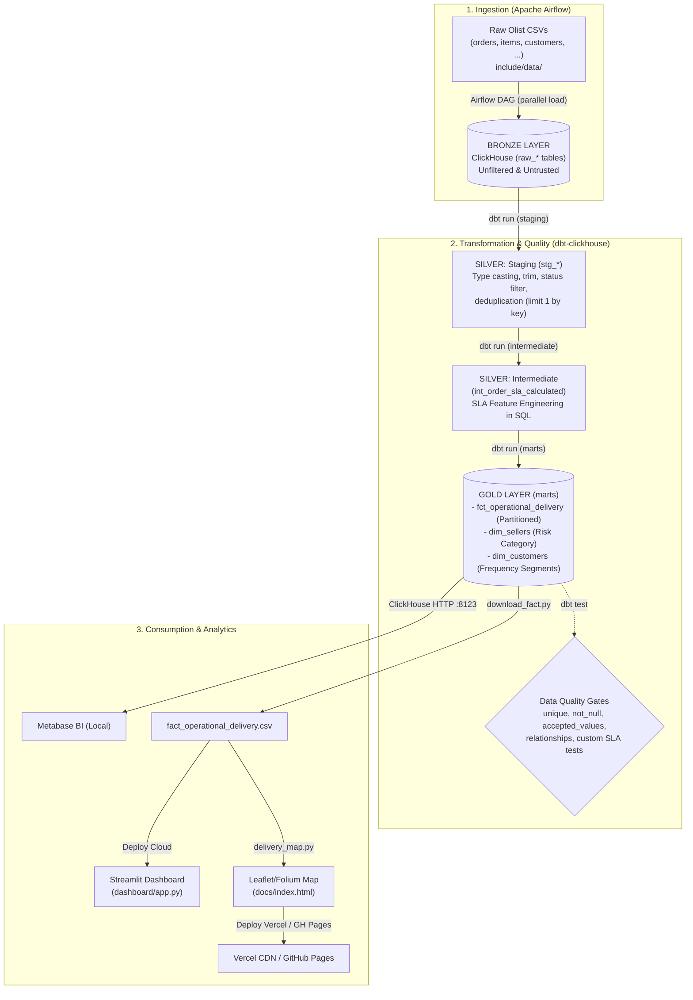

# DustiniaDelixia Groceria — Modern Analytics Engineering & Delivery SLA Platform

[](https://github.com/Mahendra-TC24/FP-MCI---Logistic-Analytic/actions/workflows/ci.yml)
[](https://github.com/Mahendra-TC24/FP-MCI---Logistic-Analytic/actions/workflows/deploy_docs.yml)


An end-to-end **Analytics Engineering & Business Intelligence platform** designed to identify and eliminate operational delivery bottlenecks for a Brazilian e-commerce logistics network (100k+ orders).

Built with **Apache Airflow** (orchestration), **ClickHouse** (columnar OLAP warehouse), **dbt** (Medallion transformation & data modeling), **Streamlit + Plotly** (interactive web dashboard), and **Folium** (geospatial analytics).

---

## Live Interactive Demos

| Artefak Demo | Deskripsi | Link Akses |
| :--- | :--- | :--- |
| **Geospatial Delivery Map** | Peta interaktif 27 negara bagian Brazil, heatmap keterlambatan, dan metrik SLA per rute | [Buka Live Map](https://mahendra-tc24.github.io/FP-MCI---Logistic-Analytic/) |
| **dbt Docs & Lineage Graph** | Kamus data interaktif, dokumentasi model, schema tests, dan DAG visual lineage | [Buka dbt Documentation](https://mahendra-tc24.github.io/FP-MCI---Logistic-Analytic/dbt/) |
| **Streamlit Operations App** | Executive scorecard, bottleneck SLA per stage, analisis seller berisiko, dan simulator filter | [Buka Streamlit App](https://share.streamlit.io/) *(Lihat panduan deploy)* |

---

## Modern ELT & Medallion Architecture



---

## Key Executive Findings & Business Insights

| Metrik Kunci | Nilai Saat Ini | Temuan & Rekomendasi Bisnis |
| :--- | :--- | :--- |
| **On-Time Delivery Rate** | **91.89%** | Tingkat ketepatan waktu nasional dapat diterima, namun memiliki variansi regional ekstrem. |
| **Average Delivery Time** | **12.56 hari** | Rata-rata durasi pemenuhan pesanan dari klik beli hingga sampai ke tangan pelanggan. |
| **Carrier Transit Bottleneck** | **9.33 hari (74.3%)** | **Akar Masalah Utama:** 74% dari total waktu tunggu terjadi di perjalanan kurir, bukan di pemrosesan seller (2.82 hari) maupun persetujuan pembayaran (0.43 hari). |
| **Regional Disparity** | **MA (19.6%), AL (23.9%)** | Negara bagian di wilayah Northeast Brazil memiliki rasio keterlambatan hingga **3x lipat** dibandingkan Southeast (SP, SC, PR < 6%). Diperlukan *Regional Fulfillment Center* di Salvador atau Fortaleza. |
| **Customer Satisfaction Drop** | **4.29 $\to$ 2.57 (skala 5.0)** | Keterlambatan pengiriman menyebabkan skor kepuasan ulasan anjlok **1.72 poin**, dan pesanan terlambat >14 hari jatuh ke skor **1.71 / 5.0**. |

---

## Struktur Repositori

```text
├── .github/workflows/          # CI/CD Workflows
│   ├── ci.yml                  # SQLFluff lint, dbt compile, test against ClickHouse container
│   └── deploy_docs.yml         # Auto-build dbt docs & deploy to GitHub Pages
├── dashboard/                  # Public Streamlit Application
│   ├── app.py                  # Streamlit + Plotly interactive dashboard
│   ├── requirements.txt        # Dependencies untuk Streamlit Cloud
│   └── README.md               # Panduan deployment dashboard
├── docs/                       # Static Web Portal (Ready for GitHub Pages & Vercel)
│   ├── index.html              # Peta interaktif performa pengiriman Brazil
│   ├── .nojekyll               # Bypass Jekyll parser di GitHub Pages
│   └── dbt/                    # Compiled interactive dbt documentation & lineage graph
├── DustiniaDelixia_Groceria/   # Core Data Platform
│   ├── dags/
│   │   └── operational_analyst_dag.py  # ELT Airflow DAG (Bronze Ingest -> dbt Run -> dbt Test)
│   ├── dbt_dustinia/           # dbt-clickhouse project
│   │   ├── dbt_project.yml     # Medallion layer configuration (staging, intermediate, marts)
│   │   ├── profiles.yml        # Dev (localhost:8123) & Prod ClickHouse profiles
│   │   ├── macros/             # Custom schema name resolver macro
│   │   ├── models/             # Modular SQL models (Bronze -> Silver -> Gold)
│   │   └── tests/              # Custom singular SLA and data integrity tests
│   ├── include/data/           # Raw Brazilian E-Commerce (Olist) CSV datasets
│   ├── sql/
│   │   └── create_raw_tables.sql  # DDL tabel Bronze di ClickHouse
│   ├── delivery_map.py         # Skrip generator peta Folium geospatial
│   ├── download_fact.py        # Utility ekspor Gold fact table dari ClickHouse ke CSV
│   ├── docker-compose.yaml     # Orchestrasi multi-container (Airflow, ClickHouse, Metabase, Postgres)
│   └── Dockerfile              # Custom Airflow image dengan isolated dbt-venv runtime
├── vercel.json                 # Konfigurasi deployment 1-klik untuk Vercel
└── README.md                   # Dokumentasi utama proyek
```

---

## Panduan Menjalankan Proyek Secara Lokal

### Prasyarat
- **Docker & Docker Compose** (Alokasi minimal 6–8 GB RAM direkomendasikan)
- **Python 3.10+** (untuk menjalankan script/dashboard lokal)
- **Git**

---

### Langkah 1: Jalankan Container Platform (Airflow, ClickHouse, Metabase)

Masuk ke folder `DustiniaDelixia_Groceria`:

```bash
cd DustiniaDelixia_Groceria

# 1. Build custom image (mengisolasi runtime dbt & Airflow)
docker compose build

# 2. Inisialisasi database metadata Airflow (sekali saja)
docker compose up airflow-init

# 3. Jalankan semua services di background
docker compose up -d
```

Pastikan semua service berstatus healthy:
```bash
docker compose ps
```

Layanan yang aktif:
- **Airflow Webserver**: [http://localhost:8080](http://localhost:8080) *(user: `airflow` | pass: `airflow`)*
- **ClickHouse HTTP**: [http://localhost:8123](http://localhost:8123)
- **ClickHouse Native TCP**: `localhost:9000`
- **Metabase BI**: [http://localhost:3000](http://localhost:3000)

---

### Langkah 2: Eksekusi Pipeline End-to-End di Airflow

1. Buka browser ke [http://localhost:8080](http://localhost:8080) dan login.
2. Cari DAG bernama `operational_analyst_dag`.
3. Aktifkan toggle DAG dan klik tombol **Trigger DAG**.
4. Alur eksekusi akan berjalan otomatis:
   $$\text{start} \longrightarrow \text{create\_raw\_tables} \longrightarrow \text{load\_orders, load\_items, ... (Paralel)} \longrightarrow \text{dbt\_run} \longrightarrow \text{dbt\_test} \longrightarrow \text{end}$$
5. Setelah task `dbt_run` selesai, layer **Bronze**, **Silver**, dan **Gold** di ClickHouse sudah terisi penuh!

---

### Langkah 3: Menjalankan dbt Secara Manual (Opsional)

Jika ingin menjalankan dbt langsung dari terminal lokal (di luar Airflow):

```bash
cd DustiniaDelixia_Groceria/dbt_dustinia

# Install dbt-clickhouse di virtualenv Anda
pip install -r ../requirements-dbt.txt

# Tes koneksi ke ClickHouse Docker
dbt debug --profiles-dir .

# Jalankan transformasi model Medallion
dbt run --profiles-dir .

# Jalankan pengujian kualitas data
dbt test --profiles-dir .

# Buka visualisasi data catalog dan lineage DAG
dbt docs generate --profiles-dir .
dbt docs serve --profiles-dir .
```

---

### Langkah 4: Jalankan Streamlit Dashboard Lokal

```bash
# Kembali ke root folder proyek
cd ..

# Install dependencies dashboard
pip install -r dashboard/requirements.txt

# Jalankan dashboard web
streamlit run dashboard/app.py
```
Dashboard akan otomatis terbuka di browser Anda pada alamat `http://localhost:8501`.

---

### Langkah 5: Buka Peta Interaktif Pengiriman

Cukup buka file `docs/index.html` langsung di browser Anda (atau jalankan `python DustiniaDelixia_Groceria/delivery_map.py` jika ingin meng-generate ulang dari data mentah terbaru).

---

## Panduan Deployment ke Cloud Publik

### Opsi A: Deploy Portal Statis (Peta + dbt Docs) ke Vercel
Repositori ini sudah dilengkapi file konfigurasi `vercel.json` yang siap pakai:

1. Buat akun gratis di [Vercel](https://vercel.com/) dan hubungkan dengan GitHub Anda.
2. Klik **Add New...** $\to$ **Project**.
3. Pilih repository `FP-MCI---Logistic-Analytic`.
4. Vercel akan otomatis mendeteksi `vercel.json` dengan folder output `docs`.
5. Klik **Deploy**.
6. Web Anda langsung aktif dengan alamat: `https://<nama-project>.vercel.app/`  
   - Halaman utama (`/`): Peta interaktif performa pengiriman Brazil.
   - Halaman dbt docs (`/dbt/`): Dokumentasi lengkap & interactive data lineage graph.

---

### Opsi B: Deploy Portal Statis ke GitHub Pages
File workflow `.github/workflows/deploy_docs.yml` sudah disiapkan untuk deployment otomatis:

1. Buka repository Anda di GitHub.
2. Masuk ke tab **Settings** $\to$ **Pages** (di sidebar kiri).
3. Pada bagian **Build and deployment** $\to$ **Source**, pilih **"GitHub Actions"**.
4. Lakukan `git push` ke branch `main`. Workflow akan otomatis menjalankan build dbt, menggabungkan katalog, dan mempublikasikannya ke:  
   `https://<username>.github.io/<repo>/`

---

### Opsi C: Deploy Dashboard ke Streamlit Community Cloud
1. Buka [share.streamlit.io](https://share.streamlit.io/) dan login dengan GitHub.
2. Klik tombol **New app**.
3. Isi konfigurasi:
   - **Repository**: `Mahendra-TC24/FP-MCI---Logistic-Analytic` (atau repository Anda)
   - **Branch**: `main`
   - **Main file path**: `dashboard/app.py`
4. Klik **Deploy**.
5. Dashboard Streamlit Anda langsung online dan dapat dicoba oleh siapa saja tanpa perlu backend database.

---

## Keahlian yang Ditunjukkan dalam Portofolio Ini

- **Modern Analytics Engineering**: Medallion Architecture (Bronze $\to$ Silver $\to$ Gold), modular SQL, data contracts, surrogate keys, dan ClickHouse MergeTree optimization.
- **Workflow Orchestration**: Apache Airflow DAG design, isolated Python runtimes, parallel task execution, and robust dependency graphs.
- **Data Quality & Governance**: Automated testing with dbt schema tests, data constraints (`unique`, `not_null`, `accepted_values`), and singular SQL business anomaly detectors.
- **DevOps & CI/CD**: Docker multi-stage containerization, GitHub Actions automated CI with ephemeral ClickHouse test services, and multi-cloud static artifact hosting (Vercel & GitHub Pages).
- **Business Intelligence & Storytelling**: Executive metrics design, root-cause bottleneck discovery, and interactive UI dashboards (Streamlit & Folium).

---

## Author

**Mahendra Agung Darmawan**  
*Final Project — Manajemen Cerdas Informasi (MCI)*  
- Email: [amahendra952@gmail.com](mailto:amahendra952@gmail.com)  
- GitHub: [@Mahendra-TC24](https://github.com/Mahendra-TC24)  
- Repository: [FP-MCI---Logistic-Analytic](https://github.com/Mahendra-TC24/FP-MCI---Logistic-Analytic)
